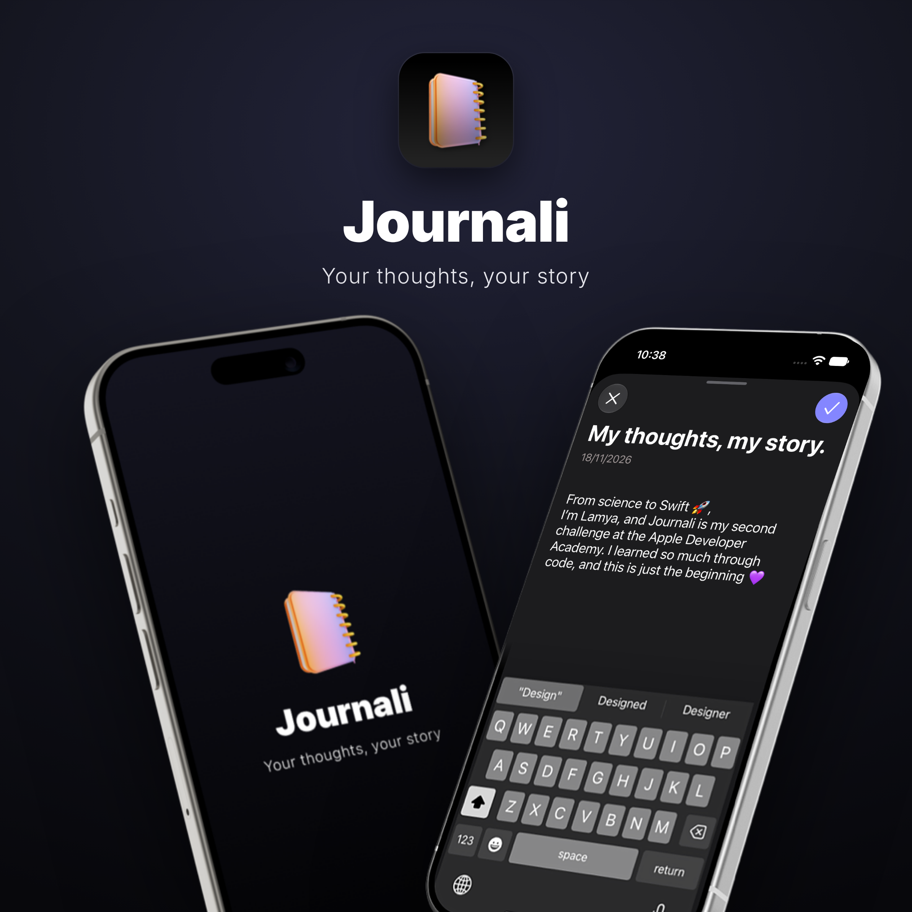

# Journali 📔
Journali is a friendly companion app designed for lovers of daily reflection, helping users capture and preserve whatever crosses their mind throughout the day.

## ✨ Features
-  📝 Write a new journal entry anytime, with a title and your thoughts 
- ✏️ Edit and delete any journal entry anytime
- 🔍 Find any entry quickly by searching just one word
- 🔖 Bookmark your favorite journal entries
- 🗄️ Sort your journal by date or by bookmark
- 💾 Works offline; your entries stay saved even after closing the app

 ## 👩🏻‍💻 Technologies
- Swift
- SwiftUI
- MVVM
- Liquid Glass
- Codable

## 🎨 Design

Journali always uses a calm dark theme, made for writing your thoughts
anytime. The app icon adapts to your device's light, dark, or tinted mode,
and the interface uses Apple's native components with Liquid Glass.

- **Typography:** SF Pro
- **Icons:** SF Symbols

| | Color | Hex | Used for |
|---|---|---|---|
|  | Primary Accent | `#7F81FF` | Save button, active actions |
|  | Text Accent | `#AF99FD` | Journal titles, empty-state heading |
|  | Text Primary | `#FFFFFF` | Main headings, journal content |
|  | Text Secondary | `#A39A9A` | Entry dates |
|  | Surface Card | `#1C1C1E` | Journal cards |
|  | Destructive | `#FD453C` | Delete action |

## 📚 What I Learned

- **MVVM:** How to separate my app into a Model (what a journal entry is),
  a ViewModel (the logic), and Views (what the user sees).
- **Sharing data between screens:** Using `@StateObject` to create the
  ViewModel once, and `@ObservedObject` to pass it to other screens.
- **State & Binding:** How `@State` stores data inside a view, and how `$`
  lets another view read and change it.
- **Saving data offline:** Using `Codable` to save my journal entries to the
  device, so they stay after closing the app.
- **Native iOS components:** Building with sheets, alerts, swipe actions,
  search, and Liquid Glass instead of designing everything from scratch.
- **Handling empty states:** Showing the right message when there are no
  entries or no search results.
- **Debugging:** A single missing dot before `.sheet` froze my whole app,
  even though the build succeeded. Small details matter! 😅

